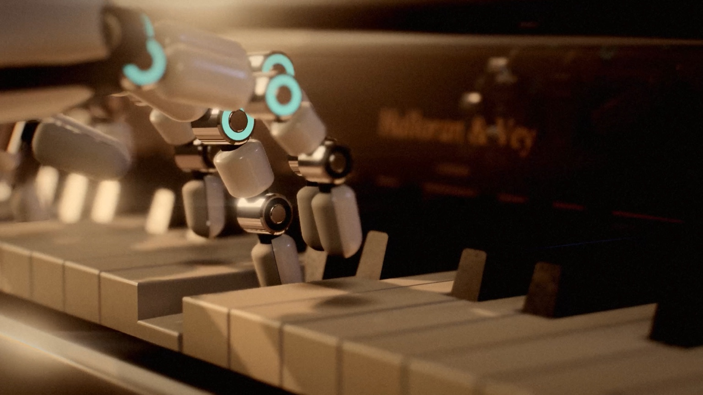

# The Mechanical Pianist

A browser application that turns a MIDI piano performance into a close, cinematic, real-time film of two articulated robotic hands playing an old upright piano.

There are no falling notes or piano-roll bars. The application works out how a skilled pianist would play the piece (which hand, which finger, where the hand should be and when it should start moving), then animates the physical act: fingers that land on keys, push them down on the beat, hold them, ride them back up and travel to the next note.

The build has three layers, and each one only hands data to the next:

| Layer | Turns | Into |
|---|---|---|
| **Musical interpretation** (`src/interpretation`) | MIDI | notes → hand assignment → fingering |
| **Physical performance** (`src/performance`) | fingering | hand trajectories → joint poses → key contact |
| **Cinematic presentation** (`src/presentation`) | poses at time *t* | piano, hands, light, lens, camera |

The fingering is solved for the whole piece before anything is drawn, so the hands always know what comes next. Because the layers only share data, the robot, the piano or the camera language can be replaced without touching the interpretation.

## Run it

Needs Node 20+ (tested on 22).

```bash
npm install
npm run dev          # http://127.0.0.1:5174
npm run build        # static site in dist/, with the library's plans prepared (open with `npm run preview`)
npm test             # interpretation + kinematics tests (vitest)
```

The piano samples are checked in under `public/piano`. `npm run dev` and `npm run build` also copy the key-release noises from `node_modules` into `public/samples`, since those are not checked in. If the piano samples cannot load, the app falls back to a synthesized piano.

To use a different SoundFont 2 piano, run `python tools/sf2-to-samples.py <file.sf2> public/piano`. It needs numpy and ffmpeg. The drum kit's samples are checked in under `public/drums`; `python tools/drum-samples.py <Big Rusty Drums checkout> public/drums` rebuilds them (`--paths` lists the source files it reads, so a blobless clone can fetch only those).

Choose a piece from the **Library** (the button in the control bar, the title, or `O`). To perform your own `.mid` file, use **Open a MIDI file** there or drop the file anywhere on the window. Files with several parts ask which tracks to perform, with piano parts preselected. Your files are kept under "Your files" in this browser (IndexedDB), along with the parts you chose.

URL options for development: `?demo=<library id>` (for example `nocturne-op9-2`, `raindrop` or `nocturne`, or a groove for the drum stage such as `groove-rock`, `groove-samba` or `groove-secondline`; see `src/app/library.ts` and `src/drums/drumLibrary.ts`), `?t=12.5` (start time), `?camera=cinematic|follow|overhead|macro`, `?shot=<shot id>` (hold one of the director's shots, `&hand=L` to favour the left hand), `?settings=default` (ignore saved settings), `?quality=high|medium|low`, `?debug=1`, `?play=1`, `?ui=0` (no interface, for stills).

### Publishing on GitHub Pages

`.github/workflows/pages.yml` builds the site (including the prepared library performances, cached between runs) and publishes it to GitHub Pages on every push to `main`. Once, in the repository's Settings → Pages, set **Source** to **GitHub Actions**. The site is then at `https://<user>.github.io/mechanical-pianist/`. Everything is relative to the page, so it works under any path.

### More music, kept out of the repository

The repository carries only music that can be shared freely. To build a version with more pieces, put MIDI files in `extra/music/` and describe them in `extra/library.json` (the folder is gitignored; `MP_EXTRA=<dir>` points elsewhere): an id, title, artist, year, group (`Songs`, `Classical` or `Original`), a one-line blurb and the file name for each, and optionally a `defaultPiece`. `npm run build` then plans them at build time like the rest and lists them in the library in their groups (`tools/extra-music.cjs`). Without the folder, nothing changes.

### Exporting a film

⚙ → **Export** renders the performance as an MP4: choose its shape (16:9, 2.39:1 scope, 1.85:1, 4:3, 1:1, 4:5 or 9:16 vertical), its size (1080p, 1440p or 4K on the long side), 24, 30 or 60 fps, and the whole piece or from the playhead. Every frame is drawn offline at its exact time at high quality, so a slower computer only takes longer, never drops a frame; the piano is rendered offline too (`AudioEngine.renderOffline`), with the same room, pedal halo and key noises. Both are encoded in the browser with WebCodecs (H.264 at a generous bitrate; AAC, or Opus where the browser has no AAC encoder) and muxed with `mp4-muxer` into a file streamed out as it is written (`app/VideoExport.ts`). The camera, style and look are the current ones; the interface is HTML over the canvas, so it never appears in the film, and the letterbox bars are left off because the frame itself has the chosen shape. In the published artifact the page offers the file through its `downloads` capability (the viewer confirms the save); elsewhere it is an ordinary download. `tools/render-video.cjs` renders a stretch to video from the command line instead (silent).

### Open the piano

The piano starts open: its upper front panel is off, with its music desk and candle sconces. **Close piano** on the control bar (or **I**) puts it back for the rest of the visit. Open, it shows the action at work. It is built in three.js from the same keyboard layout as the keys (`presentation/ActionLayout.ts`, `presentation/PianoInterior.ts`), so every hammer stands behind its key and every string runs where its hammer strikes:

* a hammer per key, its head of thick cream felt wrapped over a red underfelt and a beech moulding, nearly as wide as the keys' spacing allows, so that at rest the row reads as one ribbed wall. The head is longer from the moulding to the crown than it is tall, with a broad round crown, pressed smoother and a little yellowed at the strike line, where the strings have left their grooves. Each head has its number stamped on its upper side. It sits on a maple shank and a buckskin butt.
* a damper per key up to E6 (F6 and above have none, as in the sound), a soft block of felt glued with red cloth to a wooden head, and a wire running down beside the hammer.
* the mechanism below them, built in `presentation/ActionParts.ts` so the chain from key to hammer can be followed part by part:
  * each key pivots on its balance pin on the balance rail, on a felt punching, and runs on under the action, cranked toward its hammer, to rest on the back rail's cloth;
  * a brass capstan on the key's back lifts the heel of its wippen, which turns in its flange on the wippen rail;
  * the jack stands on the wippen and pushes the hammer butt's buckskin heel round. At let-off its toe meets the let-off button on the let-off rail, and it slips forward from under the butt, springing back under it as the key rises;
  * a white bridle tape runs from the hammer's catcher to the bridle wire on the front of the wippen. It hangs slack and sways a little after each blow;
  * a brass spoon on the wippen pushes the damper lever's tail toward the strings, taking the damper off them;
  * the backcheck's wire leans in as the key goes down, so its felt meets the catcher at the check, and out of the catcher's way as the key rises. Our keyboard's short lever alone would not move it far enough;
  * there are centre pins at every pivot, a flange screw for each hammer and damper, and bolts through the cast brackets that carry the main, rest and damper rails.
  * The key's back moves only as much as the keyboard's lever allows (a millimetre or two at the capstan), and the action takes it from there. Each jack keeps its foot on the wippen and its head on the butt while driving it, so its length follows the two by a few percent rather than opening a gap.
* 236 strings: steel trichords in the treble and tenor, and copper-wound bichords and single strings in the bass, overstrung on a steep diagonal across the tenor.
* a cast-iron plate in gold paint with its pin field, struts, bolts and a hitch-pin rail, the maker's name and the casting's legends raised across its top; tuning pins with their coils of string, and hitch pins.
* the treble and bass bridges on a spruce soundboard, with the maker's gold transfer in the treble.

The surfaces were matched against slow-motion footage of a real action (`presentation/InteriorShading.ts`), with all fine detail filtered by its size on screen, so it fades to its average before it can shimmer:

* **Felt** reads as felt rather than painted plastic: fine matted fibres in the colour and the surface, very matte, with the light wrapping a little past the terminator and coming back warmer, as it does out of wool, a soft sheen at grazing angles and a slightly fuzzy rim where fibres catch the light. On the sides of each head the layers show in section: the white felt, the thin dark-red U of the underfelt inside it, the wood inside that. The damper felts, the punchings and the cloth strips are the same wool.
* **Gold paint:** bronze flakes in lacquer over sand-cast iron. Up close single flakes catch the light; further off it is a satin gold. The raised letters are a little brighter, with the iron around them in their shadow.
* **Copper winding** catches light from far more directions than a smooth wire, so the bass strings never go black facing the dark cabinet.
* **Wood:** a fine straight grain along each part of the action, with a beech moulding's flecks; dust lies on whatever faces up.

The moving parts are pure functions of time from the same key strokes that move the keys (`performance/ActionMechanics.ts`), as deterministic as everything else:

* **Hammers** move as slow-motion footage of a real upright action shows them:
  * Each hammer eases out of the resting row and accelerates under the jack, covering most of its travel in the second half of the rise.
  * The jack trips a few millimetres short of the string (let-off), and the hammer flies the rest of the way on its own, slowing into the string.
  * It reaches the string exactly at the note onset and lingers there, for contact and felt compression, for about a fifth of the rise, without bouncing off.
  * It comes back about twice as fast as it rose, and its catcher lands in the backcheck's felt (the felt-faced check on its wire at the front of the wippen). It sinks in past the check by 10–15% of its travel, as tracked frame by frame in the footage, and springs back out past it by about a fifth of that. It settles in an elastic ease-out: about one and a half swings to see, over one to one and a half times its rise. It then holds still while the key is down.
  * When the key lets go it falls, gathering speed, to its rest rail. It comes off the rail's felt in a small bounce (a few percent of its travel) and a smaller one, and lies still.
  * Every strike settles a little differently: about ±30% in size and ±15% in time, fixed per strike. Loud blows sink further into the check, and a quick release bounces more at the rail than a slow one.
  * A soft note rises more slowly, rebounds more gently and is caught a little higher than a loud one.
  * As in a real action, the hammers of a chord are never quite in unison. Each note has its own lost motion before the jack takes up, and its own small differences in linger, rebound and check. They all strike on their onsets but sit at different heights in between.
  * A repeated note strikes again from wherever the half-risen key left it.
  * No hammer swings in a perfect plane. Each one leans a hint to one side and twists a hint about its shank as it rises (a few tenths of a millimetre at the head over the whole blow), with a smaller difference every strike. The dampers do the same as they lift, and nothing moves at rest.
* **Dampers:**
  * A damper lifts in the second half of its key's travel, falls back a moment after the key rises, and its felt gives a little as it lands.
  * The sustain pedal lifts every damper together on the damper lift rail, visible behind the damper wires. Each damper meets the rail at a slightly different point, and half-pedalling (the MIDI controller's in-between values) lifts them part of the way.
  * The dampers clear the strings, and the strings ring, once the pedal is half down, matching where the sound counts it as down.
* **Soft pedal** (CC67): it moves the hammer rest rail toward the strings, so every hammer rests, and starts its blow, a third of the way closer (`performance/Pedals.ts`). Satie's Gnossienne holds it throughout. The sound is unchanged.
* **Strings** (`performance/StringMechanics.ts`): each string swings by a physical amount, set by velocity and register. That is a few millimetres at mid-span for a bass string struck hard, a few tenths in the middle and hundredths at the top. It dies away in two stages, the quick prompt sound and then the long aftersound, slowly in the bass and quickly in the treble. Once its damper is back on the strings (the key risen past where it lifts the damper, and the pedal up), the swing dies within tens of milliseconds in the treble and a few hundred in the bass, rather than stopping dead. The undamped top strings and pedalled strings ring on. While the dampers are off, strings that share a partial with a sounding note (octaves, twelfths, fifths) pick up a faint sympathetic swing. The swing starts in the hammer's plane, toward the soundboard, and turns partly into the other polarisation over a few tenths of a second.

A string vibrates far faster than any frame rate, so a camera never sees a moving wire. It sees the envelope of the swing over the exposure, which is how the strings are drawn. Each string is a ribbon facing the camera, as wide as the wire plus the part of its swing seen across the line of sight, with the first mode's shape: widest at mid-span and pinched at the bridge and the top bearing. Every pixel takes the share of the exposure the wire covers it, so a swinging string becomes a translucent band, brightest at its edges where the wire lingers as it turns. The band holds exactly the wire's light, however wide it spreads. In practice only loud bass notes blur visibly, and mostly when seen from above or from the side. The same filter gives distant strings, thinner than a pixel, a steady faint line instead of a broken, flickering one. The normal across the ribbon is the round wire's, so light runs along each string in a bright streak; where a wire is only a pixel or two wide, its highlight broadens instead of depending on where the pixel falls.

Hammers, dampers and wippens are instanced, and keep their transforms from the start of the shutter for motion blur.

The light inside (`presentation/InteriorLight.ts`): with the panel off, the case is a deep box with one opening, and nearly all its light comes in through it.

* **Direct light** reaches a point inside only along a line through the opening. This is tested analytically for every light at every pixel. The penumbra grows with the distance to the opening's edge and with the size of the source: crisp for the sun and the raking lamp, wide for the fill and the window. So the light falls in under the lid's edge and across the action from the window's side, and leaves the top of the case, the pins and the far corners in shadow. The shadow maps still draw what the parts inside cast on one another, and the sun's map reaches up under the lid while the piano is open.
* **Light from the room** (sky fill, bounced light, reflections) is scaled by how much of what a surface faces is the opening rather than the dark inside of the case, with a little left over for what the inside bounces about. Reflections look out along the mirror direction.
* **Between the rows**: hammers, dampers and wippens stand a millimetre or two apart. Where a part's neighbour stands level with it, the slot between them is dark: its faces see out only near the mouth, and the faces beside it darken toward the gap. When a neighbour rises out of the row, the slot opens and lights up. Each part carries its neighbours' state as instance attributes, worked out every frame from the posed parts themselves.
* **No relighting delay**: the room's bounced light and the hands' reflections are prepared at load for the piano both open and closed, so opening or closing it relights at once, on the next frame.

With the piano open, the cinematic director also goes inside now and then: about one cut in six or seven, never twice running, and not in the first two shots or the last. It chooses the moments for a soft or held passage, a big chord at the cut, or the start of a phrase. Inside, the focus is pulled from hammer to hammer with the melody, the top note of the hand's chords. A focus puller would start each pull a little ahead of the note, ease it to a stop, and take longer for a longer distance. A pull that starts before the last has finished carries on from its speed, so the focus never jerks. There are four shots inside:

* *The hammers*, a close-up above the leading hand, focused on the melody's hammer where it stands while its note sounds;
* *Along the hammer line*, a long lens wide open from one end, the focus travelling along the line with the melody;
* *Through the action*, looking out past the dampers and hammers to the hands;
* *The plate and the pins*, a crane down from the tuning pins to the hammers.

### Playing live

**Play live** (or **K**) hands the robot to you: play a MIDI keyboard, or the computer keyboard, and the hands play what you play a moment later. Any MIDI keyboard connected to the computer works (Chrome and Edge, through Web MIDI; plug it in or out at any time; the sustain pedal too). The computer keyboard is laid out the way music software lays it out: the middle row from **A** is the white keys from C, the row above (**W E T Y U O P**) the black keys, **Z** / **X** move an octave down or up, **C** / **V** play softer or louder, and the space bar is the sustain pedal. The small keyboard in the panel shows the layout, lights up with whatever is held, and can itself be played with a finger on a touch screen. Where the page cannot reach MIDI devices (some browsers, and the published artifact's frame), the computer keyboard and the touch keyboard still work.

The robot plays each note a fixed delay after you (0.35 s by default; 0.2 to 1 s under **Robot follows**), which is how far ahead it can see: like a sight-reader, it reads that much of what is coming and moves its hands in time to play it. By default the piano sounds as the robot strikes, so picture and sound go together; **Hear my playing at once** plays your notes immediately and lets the robot follow. The camera keeps working (1–4 or the switch in the panel): the cinematic director, with no score to cut to, moves between calm shots every few seconds, opening along the keys into the light, with close-ups on whichever hand is playing. **Esc** or **Back to the piece** returns to the piece where it was.

How it works (`src/live/`). A piece is planned ahead in one go; live playing is planned a few seconds at a time, by the same layers. On a fixed grid (every 1/30 s), whenever something was played (or a key is still held and its hold needs extending), a *window* is planned from everything known at that moment: the last second of what the robot has played and everything it has yet to play, with keys still held assumed held a little longer (`LivePlanner`). Hand assignment starts from where the hands actually are, and the hand and finger of every note the robot is already playing are fixed (committed), so later windows can only plan what has not yet been shown. Windows are planned in a worker with a lighter check of the contacts (one round instead of four: a window takes a few to a few tens of milliseconds), and each takes over 0.11 s after its grid moment. At a takeover the new window's wrist path is joined to the one on screen: the difference in position and speed fades out along a quintic, over longer when the hand has further to go, so the hands never jump; the fingers and keys cross-fade over 90 ms (`LivePerformer`). Nothing before a takeover is ever planned again. Planned synchronously (the tests), the robot is a pure function of the events: the same playing gives the same motion. The camera builds the cinematographer's curves (where the hands are, how far apart, which leads, how loud) as the music happens, from the hands as planned a moment ahead, smoothed causally (`LiveCamera`). The piano's sound is struck as each note is played and damped when it is let go, or when the pedal lifts (`LiveSession`, `AudioEngine.liveStrike`).

### The drum stage

Choosing a piece from the **Drums** group in the Library opens a second stage: a drum kit in a room of the same house, in the same visual language as the piano (the same grade, bloom, grain, depth of field and motion blur, and the visual styles apply to both). A robot drummer sits at the kit and plays it (below). Choosing a piano piece goes back to the piano, exactly as it was.

**The kit** is a conventional five-piece, built in three.js from `src/drums/KitLayout.ts`, the layout it shares with the robot drummer (`presentation/DrumKitModel.ts`): every drum, cymbal and pedal stands where the layout says. The layout also holds the cymbals' profiles (bell, bow, edge), so a strike spot on a cymbal lies on the modelled metal, and the pedals' travel (`PEDAL_TRAVEL`), which the footboards and the robot's feet share. It is set for a seated adult, with the robot drummer stage's findings (hand instruments 12 to 18 cm further from the stool than first laid out, the kick and pedals 22 to 25 cm further forward) and the posture stage's (the stool 57 cm high, 5 cm higher and 8 cm further back than first set, so that the robot's elbows can hang by its body with the forearms near level, as real drummers' do: below), and moved to the nearest clear spot where parts would have collided: the hi-hat's column stands in front of the ball of the left foot, where its footboard ends; the snare clears the kick's batter hoop; the rack toms clear the snare and each other. Tripod legs are turned (and the snare stand's offset basket arm set) to keep clear of the pedals, the kick, the stool and each other.

* **Drums:** maple shells with real wall thickness and 45-degree bearing edges, in a deep blue sparkle lacquer: flakes a little over half a millimetre across, each tilted its own way, in a tinted base under a thick clear coat. Up close single flakes catch the light; further off they average to a blue metallic. The coat carries a few fingerprints and smudges. Coated batter heads sit over the edges in their flesh hoops, with the head maker's logo printed on the far side, readable from the stool; where the sticks land the coating is worn a little greyer, smoother and more glossy, scattered with stick-tip marks. Triple-flanged chrome hoops, scuffed where rimshots land; lugs, tension rods and washers (instanced); an oval maker's badge.
* **Snare:** tube lugs, twenty wires under the bottom head with their end plates and straps, a throw-off strainer with its lever and tension knob, a butt plate. **Kick:** wooden hoops in the shell's finish, claws and T-rods, spurs, a beater patch on the batter head, and a black front head with a reinforced port and the maker's emblem in white and gold. **Toms** on a holder on the kick, each on its own arm; the **floor tom** on three legs.
* **Hardware:** tripod stands with braces, rubber feet, memory locks and wing bolts; boom arms with ratchet tilters and counterweights; cymbal tilters with a cup washer, felts, a nylon sleeve, a washer and a wing nut. The hi-hat stand with its pedal, pull rod, seat cup with its tilt screw and a clutch with two felts; the kick pedal with a cast footboard (the maker's name cast in), heel plate, chain, cam, axle, spring and a felt beater; a padded stool; a worn Persian-style rug (border, medallion, a field of small flowers, the dye lots changing across it, the pile flattened where the stool and feet go). The tripods' legs are placed to keep clear of the pedals, the kick and each other.
* **Cymbals** (an 18" crash, a 21" ride, 14" hi-hats) are turned from a real profile (bell, bow, edge, thinning toward the edge) in B20 bronze. They are lathed: rough across the grooves and smooth along them, so the highlights fan out radially as on a real cymbal (anisotropic shading, its direction taken from the geometry), with tonal grooves banding the fan, scattered hammer peens, a faint stamped logo, a little tarnish, and stick marks and fingerprints at the edge.
* The makers are invented: "Corbel & Wren" (drums), "Aldane" (heads), "Marrowby" (cymbals). As everywhere in the app, fine detail fades to its average before it is small enough to shimmer.

**The room and its light** (`presentation/DrumStage.ts`): oak boards and dark plaster as in the piano's room, a dado rail, a tall window behind the drummer's left with late sun through drawn curtains, crossing the kit as shafts with dust drifting in them (the same volumetric pass as the piano's). The sun reaches only what the window lets it: the window's wall casts its shadow into the kit's shadow map, and the room's own surfaces test the window's opening and bars analytically, with a penumbra that widens with distance. A cool fill, a soft fill from the front, and a practical: a standard lamp in the corner behind the floor tom, which is also the kit's (warm) rim light; a directional rim, casting no shadow, glinted off chrome that should be in the drums' shadow. The room's bounced light is captured from the lit scene at three heights and two bounces, and the chrome and bronze reflect a capture of the room itself. The kit stands where the piano stands in the house's frame, so the shared height bands of the bounced light and the dusty air fit it too; its bounced light is swapped into the shared uniforms only while it draws, and the piano's put straight back.

**The kit reacts to the performance** (`drums/KitMotion.ts`), all as pure functions of the time *t* from the hits, as deterministic as the piano:

* **Cymbals** rock on their felts after each hit, struck side down, as damped oscillators, by an amount set by the velocity and by how far out the stick lands (an edge hit tips a crash about 10 degrees; the bell hardly moves it). A slower, weaker rocking about the other axis makes the swing precess. The shape was measured from the user's slow-motion footage of struck cymbals, tracked frame by frame (the rim's height on both sides by normalised cross-correlation, and the silhouette's thickness): a crash on a tilter swings with a damping ratio of about 0.17 (it peaks about a fifth of a period after the hit and is back through rest at half a period); a cymbal clamped in a hi-hat clutch about 0.4 (each swing a fifth to a quarter of the last); and a fast wobble at 17 to 20 times the swing's frequency rides on it at 5 to 10 percent of its size. The slow-motion factor is unknown, so only these ratios come from the footage; the real periods are set from how kits move at normal speed (a crash about 0.6 s). The wobble is faster than a film frame, so it is drawn as the camera sees it, averaged over the exposure. Every hit settles a little differently. Cymbal chokes (polyphonic aftertouch, as e-kits send a grabbed cymbal) stop the swing within a few tens of milliseconds, and the sound with it.
* **The hi-hat** opens and closes with its pedal: CC4 where the file has it (an e-kit's pedal position; the TD-11 sends about 90 when fully closed), otherwise inferred from the notes (the foot lifts just before an open hit and comes down on the next closed or pedal note; a pedal note while closed is a lift and a press). The top cymbal, its clutch and the footboard follow; struck open, the top cymbal rocks and is stopped by the bottom one as it closes.
* **The kick beater** eases out of rest and accelerates into the head, reaching it exactly on the note, dwells for a fifth of its approach, springs back past rest by 6 to 10 percent and settles; a stroke that starts before the last has settled starts from where the beater is. The footboard, cam, chain and spring follow it.
* **Drum heads** shimmer for a moment: a vibrating head is never seen moving, only as its highlight smeared over the exposure, the way the piano's strings are drawn. **Snare wires** buzz with the snare, and in sympathy with the kick and toms (drawn as an exposure blur too). **Toms** rock a little on their arms (and tremble when the kick is struck); the floor tom less, on its legs. **The stands** give a little with their cymbals (about 3.5 percent of the cymbal's tilt, as measured at the clutch in the footage).

**The sound** (`drums/DrumAudio.ts`): Karoryfer's Big Rusty Drums (CC0), converted by `tools/drum-samples.py` into 210 stereo MP3s (3.4 MB) in `public/drums`: three to six velocity layers per articulation with two or three round-robin alternates each, mixed from the library's close and overhead microphones as its own basic program mixes them. The hi-hat has six openness levels (tight, closed, loose, quarter, half and fully open, chosen by the pedal at each hit), its edge, the pedal's chick and the foot splash; the snare its rimshot and cross-stick; the ride its bell and edge; the crash and ride their chokes. An open hi-hat is cut off where the pedal closes it; the toms are tuned up a little toward this kit's smaller drums; a small synthesized room adds some air. Every choice (layer, alternate, cut-off) is made once for the whole piece from the hits, so the sound is as deterministic as the picture. It runs on the app's master clock like the piano: each sample's measured attack (not its first sample) is placed on the hit, and the output compressor's 6 ms look-ahead is allowed for, so a hit lands on its frame (measured on an offline render: within a millisecond). If the samples cannot load, a synthesized kit (`drums/drumSynth.ts`) plays instead.

**The music** (`drums/DrumScore.ts`): General MIDI drums (channel 10) are mapped onto the kit, with the Roland TD-11's variants used by Google's Groove MIDI Dataset: closed and open hi-hat on the bow and the edge (42, 46, 22, 26), the pedal (44), rimshots and cross-stick (40, 37), the toms' rims, the ride's bell and edge (53, 59), and both crashes' bows and edges onto the one crash. Keys for hand percussion the kit does not have are left out. A cross-stick is laid across the drum, its shaft on the far hoop; one with another snare note within 0.35 s, where there is no time to lay the stick down and lift it again (a second line's rolls, a rock backbeat's neighbours), is a rim click, struck where a rimshot is, and still sounds as the cross-stick it was. The time signature sets the bars and the felt beat: four or three beats to a bar, two dotted-quarter beats in 6/8; the sticking's lead on the beats, the drummer's nod and the camera's cuts follow them.

Sixteen performances by six professional drummers from the Groove MIDI Dataset are in the library (`src/drums/drumLibrary.ts`), listed by family of styles: rock (87 and 135 bpm, and 6/8), pop and a country train beat; funk, soul and hip-hop; a New Orleans second line and shuffle; jazz at 93 and 158 bpm; a samba and a reggae one-drop; afrobeat and highlife. They were chosen from the dataset's 503 beats (played whole, 35 to 155 s) for their style and for how cleanly the drummer plays them (below).

**The drummer's performance** (`drums/DrummerMotion.ts`) is planned when the piece opens, from which limb plays each hit (`drums/Sticking.ts`), and evaluated as a pure function of *t* (the same instant gives the same pose however it was reached; evaluating allocates nothing), then turned into a pose by the robot's IK (`drums/DrummerIK.ts`):

* **Strokes** are shaped from footage of real players, tracked frame by frame (the stick's tip against time): a stroke's height follows its loudness (ghost notes 1-3 cm, taps 5-10, accents 25-40), its velocity within that and the tempo (a hand cannot lift as far between fast strokes), and varies a little from hit to hit; the downstroke accelerates all the way into the head, dwells a few milliseconds and leaves at about two thirds of its speed. Full, down, up and tap strokes follow from this stroke and the next: after a tap the stick is held just off the head and lifts late, after an accent it rebounds further. Big slow strokes lead with the forearm, the hand peaking and dropping while the stick stays up, then the wrist snapping it down; fast soft ones are wrist and fingers, the stick rocking in the grip. Doubles come off the rebound, buzz strokes press, a flam's grace note comes from a few centimetres. Crashes are struck with the stick's shoulder across the edge and follow through; the ride's bow and its bell with the tip (the bell steeper, clear of the crown and the wing nut), its edge with the shoulder; rimshots and rim clicks lay the stick flatter, the shaft on the rim as the tip lands; a cross-stick lays the left stick nearly flat across the snare from the hand resting on its near half, the shaft on the far hoop a few centimetres from the tip, and lifts only the far end, a few centimetres (the grip cannot turn the stick round, as some players do). Wherever both hands play the snare (two strokes or more, each within an eighth at 120 bpm of the last, both hands among them) each hand plays its own side, 2.5 cm from the hit's spot, so the sticks make a V rather than crossing; a rimshot or rim click is struck on the hand's own side of the near rim (26 degrees round it), its stick turned from there toward the middle of the head, and the left hand plays the hi-hat's edge from its left side. A low stroke is the wrist's own turn; a big one's tip rises nearly straight up in the stick's plane, the forearm rolling with it, rather than swinging sideways. A cymbal is struck where it is at that moment, still swinging or lifted by its pedal (`drums/KitPose.ts`).
* **Moves** between instruments follow minimum-jerk paths, leaving early enough to arrive before the downstroke (a hurried one carries on into it), lifted clear of what lies between (over a cymbal between two drums, over the second rack tom between the first and the floor tom as high as the time allows, higher over the other arm when crossing). After a fill or a crash, with time before its next stroke, the left hand goes home: a minimum-jerk move of its own straight back over its side of the snare, where it waits, rather than over the drum it left (where the right arm crossing to the hi-hat passed over it). The left hand's stroke under the right arm crossed over it to the hi-hat has the room below that arm through its whole preparation.
* **The body** turns toward where the hands are working, smoothed and a little ahead of them, leans further for far drums, rises into big crashes and follows through; the shoulders rise with effort; the head looks a little ahead of the hands, mostly at the snare and hi-hat, nods with the pulse (more as the playing grows) and the chest breathes; nothing repeats exactly from bar to bar. The posture sits up, leaning in 7-10 degrees from the hips, the upper back a little rounded (clip 10: 4-14 degrees).
* **The feet**: the kick's footboard and the robot's right foot read one function (`KitLayout.footboardAt`) of the beater's travel (KitMotion), so the board is under the foot at every *t*; heel up, the leg lifting before loud strokes, heel down for soft feathering. The hi-hat foot follows the pedal curve, rocking heel to toe for chicks, and keeps time with a heel bounce while the hi-hat is held closed.
* **The arms** are held as real drummers hold them, measured from the user's footage with MediaPipe Pose and Hands (clip 10, a professional on a full kit from the front, the side and behind, and clip 1, the forearms side on over a snare): the elbows hang by the body (1-22 degrees out from it, bent 68-91 degrees), the forearms near level (25 degrees down to 6 up), the hands low over the drums and the wrists near straight (the hand 0-27 degrees below the forearm seen from the side). The IK's elbow hangs down, a little out and a little forward, and its comfort costs an elbow winged out past 17 degrees, a bent wrist and a hand turned far from its planned grip; the grip is turned 17 degrees from palm-down on the drums (31 before), so the hand points less steeply down at the stick. Across the sixteen grooves, at the snare the elbows are now -11 to 13 degrees out (5 to 48 before), the wrists 6-15 cm over the spot (6-18), the hand 2-25 degrees below the forearm (5-55) and the wrist flexed 1-29 degrees (6-68); the toms' forearms rise 14-24 degrees to the hand (28-47). Reaching up and out (the ride and its bell, and for the right hand far across to the crash) the upper arm is raised out from the shoulder, as clip 10 shows from behind (46.6-51.6 s, his right arm up at the cymbals: the elbow 30-50 degrees out, bent 73-113, the forearm from 2 degrees down to 23 up, the elbow up to 8 cm below the wrist): the reach model (`DrummerIK.elbowRise`) is a smooth function of where a stroke lands from the shoulder, planned with each stroke and carried with the hand between strokes (rising late on the way up, so a stick leaving the floor tom clears the ride's edge first), and the IK takes it as the elbow's preferred direction and as the out-angle its comfort aims for, so the arm keeps one continuous way of holding the stick and never hops between two. At the ride the elbow is now 48-62 degrees out (13-58 before, mostly 14), bent 78-94 (82-110), the forearm rising 22-33 degrees to the hand (40-44), the hand 15-20 degrees below it (29-34) and the wrist bent 17-22 (30-35); the right hand crossing to the crash rises the same way (its forearm 20-22 degrees, 31-32 before). The left hand's stick on the first rack tom is turned less far from the hi-hat (its wrist bent 15-21 degrees, 16-35 before; 17 in the named pose, 43 before). Still not right: at the snare the elbow is bent 110-114 degrees (real drummers 68-91) and hangs at the wrist's height a little behind the shoulder, unchanged: a stool 3 to 10 cm further back (and up to 5 cm higher) bends it 90-103, but then the right hand cannot reach the crash where the funk crosses its arms (the left on the floor tom), the shoulder past its stops by up to 37 degrees, even with the reach model (and with the crash brought 10 cm nearer as a drummer would after moving the stool, the right stick hits it while playing the hi-hat beneath; raised clear of that, it is out of reach again); a stool 3 cm higher (104-106) made the frame audit a little worse in eleven places; and tilting the snare 3 degrees more toward the drummer (to lower the hands 1 cm) puts its far hoop into the first rack tom. The ride's elbow comes out 5-10 degrees further than his, because the robot's ride sits nearer its shoulder's height; the left hand's crash keeps a hanging elbow (raised, the arm changed its hold on the stick abruptly as it came back down to the snare).
* **The arms' free choices** (how a hand is turned about its stick and the stick's line across the surface, each as an offset from the planned one, and the elbow's swivel) are planned at keys (each stroke's contact and preparation, the middles of moves), in time order, each from the one before, with a full search where that would leave a joint past its range or an arm in the kit, and keys added where interpolating between two would; a frame interpolates them and refines only where its arms cost much more than the keys around it, and where even that leaves a joint near its stop (two keys holding an arm in quite different ways), takes the nearer key's. A frame's pose costs about a millisecond.

On the stage the robot casts and receives shadows, and every part of it carries its previous transform into the motion-blur prepass, so the sticks blur like a camera sees them. The drummer lab (`drummer-lab.html`, development only) plays a piece with a scrubber (`?piece=groove-rock`).

**The camera** (`presentation/DrumCamera.ts`) is temporary, until the drummer's director: six views, each fixed or moving slowly (three-quarter from the front, overhead and turning, low by the kick into the window, close on the snare, along the cymbals, over the drummer's shoulder). **Cinematic** cuts between them on bar lines, about every 6 to 9 seconds, preferring a bar that opens with a crash, 50 ms ahead of the downbeat; the arrows hold one.

### Controls

| Action | Control |
|---|---|
| Play / pause | Space, or ▶ (sound starts on the first Play) |
| Scrub | drag the timeline (sound is silent while dragging and resumes where you let go) |
| Previous / next frame (1/30 s) | ← / → or the step buttons |
| Back / forward 1 s | Shift + ← / → |
| Start / end, restart | Home / End, ⏮ |
| Speed (0.25×–1.5×) | the speed menu, `[` / `]` |
| Cinematic: the director cuts between shots | 1, or Cinematic on the bar |
| Previous / next shot, held with a gentle follow | , / . or ‹ › on the bar |
| Hold the Follow, Overhead or Macro shot | 2 / 3 / 4 |
| Next / previous visual style | S / Shift + S |
| Mute, volume | M, the volume slider |
| Library: choose a piece or open a file | O, the Library button, or the title |
| Close the library, a dialog or the drawer | Esc |
| Settings drawer (fingering, light, camera, sound, export, debug) | A, or Settings |
| Kinematics overlay | D |
| Play live (your MIDI keyboard, or the computer keyboard) | K, or Play live; then A–' and W–P as a piano, Z / X octave, C / V loudness, Space the pedal, 1–4 cameras, Esc to leave |
| Open / close the piano (upper panel off: hammers, dampers, strings) | I, or Open piano on the bar |

## The library

The library is laid out like a concert programme, in groups, each in order of year; the drums, all from 2019, are headed by family of styles. Satie's Gnossienne No. 1 plays first.

| Piece | Composer | |
|---|---|---|
| Nocturne in E♭ major, Op. 9 No. 2 | Frédéric Chopin | 1832 |
| Prelude in D♭ major, Op. 28 No. 15 “Raindrop” | Frédéric Chopin | 1839 |
| Gnossienne No. 1 | Erik Satie | 1890 |
| Maple Leaf Rag | Scott Joplin | 1899 |
| Nocturne for Mechanical Hands, Études, Five-Note Phrase | The Mechanical Pianist | |
| Drums, by family: Rock (87 and 135 bpm), Rock in 6/8 (80), Pop (132), Country (114); Funk (102), Soul (105), Hip-hop (87); Second line (124), New Orleans shuffle (104); Jazz (93 and 158); Samba (93), Reggae (78); Afrobeat (103), Highlife (126) | Groove MIDI Dataset: drummers 1, 4, 5, 6, 7 and 8 | 2019 |

The classical pieces are public-domain compositions, played from piano MIDI performances in `src/music/` that are inlined into the build (nothing is fetched). To add a piece, put its `.mid` in `src/music/` and an entry in `src/app/library.ts`; `tools/trim-midi.cjs` cuts stray notes or silence from the start of a file. Your own files can also be opened in the app at any time (they stay in your browser).

**Prepared at build time.** Interpreting a long piece takes a while: 10 to 40 seconds. So `npm run build` plans every library piece in advance (`tools/plan-library.cjs`, one process per core, about a minute) and ships the results in `public/plans/`, gzipped (1 to 2.5 MB each). A visitor downloads the finished performance, which opens in a fraction of a second. The plans are deterministic, so a prepared plan is exactly the one the browser would compute. Each carries the hash of the planner's source and a fingerprint of its MIDI file, and the app only uses a plan whose hash and fingerprint match its own code and file. A piece is re-planned at build time only when one of them changes (`npm run plans -- --force` redoes them all). The file format is in `src/app/planCodec.ts`.

**Planning in the browser.** Your own files, other parts, fingering overrides, and the dev server (whose code is usually newer than the last build's plans) are planned in a Web Worker (`src/app/planner.worker.ts`). The current piece keeps playing meanwhile, and progress shows under the title. The result is kept in this browser (IndexedDB), keyed by the file, the chosen parts, the overrides and the planner hash, so a piece opens at once the second time. Where workers are unavailable, planning falls back to the page itself.

### The original pieces

**Nocturne for Mechanical Hands** (original, A minor, about 90 s) is written as data in `src/interpretation/demoPiece.ts` and rendered to a real Standard MIDI File at startup, so it goes through the same parser as your files. It has two tracks, tempo changes and sustain pedal:

1. a slow melody over a broken-chord left hand (it opens with the five-note phrase A–C–E–D–C),
2. flowing arpeggios handed from the left hand to the right,
3. a two-octave A harmonic minor scale up and down with thumb crossings,
4. rich two-handed chords, pedalled,
5. a two-octave leap in both hands,
6. the opening returns, and a quiet A major chord with a long release.

**Five-Note Phrase** is that opening on its own: the first visual milestone.

**Études for Mechanical Hands** strings the test passages together so each can be watched (and inspected with the debug overlay): a five-finger position in each hand, two-octave scales in both hands with thumb crossings, a trill, fast repeated notes, a tempo change into fast arpeggios in both hands, wide leaps from the bass to the top of the keyboard, interlocking hands in the same register, and pedalled two-handed chords.

## How it works

### Interpretation

* **`MidiEngine`** reads the file with `@tonejs/midi`, applies the tempo map, folds out-of-range notes by octaves, merges duplicate notes, makes sure a key is released before it is struck again, and extracts the sustain pedal (CC 64).
* **`HandAssignment`** is a beam search over onset groups. Each state knows where both hands are, what each is holding and when it last moved. Every split of a chord between the hands is scored for count (at most five fingers), span, travel speed, collisions, register and, when the file separates the hands into tracks, the track. A hand may let go of a key it is holding to play elsewhere, cheaply while the pedal keeps the sound and at a higher cost without it: a low octave caught by the pedal does not pin the left hand to the bass while the right is handed a two-octave chord. Overrides are hard constraints.
* **`Fingering`** is a beam search per hand whose states remember the last key each finger played and whether it is still held. Transitions follow Parncutt et al. (1997) — comfortable and practical spans per finger pair, thumb passing, weak fingers, thumb and fifth on black keys — extended to chords, held notes and timing (legato vs. detached, fast vs. slow, chord-to-chord shifts). Distances are physical: E–F is as wide as C–D. A hand spread near its limit between its outer fingers leaves the inner pairs less room. Fast repeated notes change finger down the hand (4-3-2-1); slow ones keep it.
* **`Patterns`** recognises familiar figures and hands their conventional fingerings (`Conventions.ts`) to the search as soft priors:
  * scale runs longer than a hand position, fitted to a major key or a white-key minor;
  * chromatic runs;
  * white-root arpeggios;
  * exact repeats of an earlier figure, nudged toward its first fingering.

  Priors add a cost when the search departs from them; they never force it, so a recognised fragment that fits under five fingers, or that collides with a held note, is still fingered sensibly. Recognised notes are labelled in the Fingering tab (scale, chrom., arp., motif).

  `node tools/fingering-report.cjs` writes an image comparing the engine with conventional fingering. It covers all 24 major scales over two octaves up and down, arpeggios, chords and repeated notes, and currently 98.8% of notes match. The remaining differences are turnaround variants at the top of a scale.
* **`app/plan.ts`** checks the interpretation against the physical hand. After motion planning, it scans the holds of chords and stretches at 30 Hz. If a fingertip cannot stay within 2 mm of its key, that exact hand shape is banned for that chord and the piece is planned again (at most twice). User overrides are never second-guessed.
* **`PerformancePlanner`** combines both, then makes the result physically honest: a finger that is needed elsewhere lets go of its key in time, and a held key that is out of reach of the next notes is released early enough for the hand to travel (the pedal, when down, keeps it sounding).

Anything the modelled hands genuinely cannot do (more than five notes at once, spans beyond reach) is flagged and reported in the title card and the fingering drawer. The key of a note with no free finger is not animated, rather than moving under a hovering finger.

### Physical performance

* **`MotionPlanner`** samples each hand's wrist position, yaw, pitch and roll at 120 Hz for the whole piece. Every note pulls the wrist toward the place that puts its finger on its key, starting as early as the music allows. The pull is blurred with a zero-phase filter, so the hand starts moving before it must (anticipation), then projected back into what is reachable while keys are held, and re-smoothed. On top come black-key depth (a thumb on a black key brings the whole hand in and the long fingers play between the black keys), lifting between phrases, arcs over leaps, a small give of the wrist on chord attacks, roll toward the playing side of the hand and turning for thumb passages.

  **Leaps:** where no key is held, the wrist follows a minimum-jerk path. Keys the hand cannot keep are let go early enough for the trip, allowing 0.08 s plus 0.7 s per metre. Onsets never move, and the sound still lasts the written note. Peak wrist speed stays under 2 m/s.

  **Repeated notes:** the earlier key lets go in time to rise most of the way before the re-strike, and the finger visibly lifts off.
* **`HandIK`** is closed-form. For each finger, abduction turns its flexion plane to the target and a preferred distal angle fixes the DIP joint, so MCP and PIP follow from the two-link solution. The thumb's CMC is a ball joint: swing spreads it in the palm plane and twist turns its flexion plane until the target lies in it.
* **`HandPoser`** evaluates every fingertip target from that finger's notes (prepare, strike, hold, release, travel), then runs a few damped Gauss–Newton steps over wrist position, yaw, roll and pitch so the fingers on keys always reach them; a step is kept only if it improves the fit, so the solve settles rather than swinging between compromises from one frame to the next. The keys are solid: where a pose would put the palm, the knuckles or the base of the thumb into them, the hand is lifted until they clear, and a key still beyond reach is left a fingertip short. (The contact refinement in `PerformanceTimeline` likewise never brings the planned wrist below 3.6 cm.)
* **`KeyMechanics`**: a key starts moving when the fingertip lands (soft notes travel more slowly), bottoms out exactly at the note onset, stays down while held and springs back on release. Coming up, it meets its rest stop and rebounds into a small dip below rest, 1–4% of its travel, then a smaller one, before settling. It never rises above rest. A brisk release (a short, loud note) dips more than a slow one, and every stroke a little differently. Repeated notes restrike a half-risen key. Keys pivot on a balance rail rather than sliding.
* **`PerformanceTimeline.evaluate(t)`** returns keys, both hands' joints, finger phases, pedal and sounding notes for any *t*, as a pure function. After planning it checks every held key against the hand and re-plans where needed.

The robot's dimensions live in `src/core/hand_spec.json`, read by the Blender build, the IK and the fingering model alike. The keyboard layout in `src/core/keyboard.ts` is shared by the planner, the IK and the piano model.

* **Hands playing close together.** The two hands are checked against each other as sets of capsules (each thumb and finger segment, three across the palm; `HandCollision.ts`). In practice they meet thumb to thumb, or a thumb against the other hand's index finger or palm, when both play in the same octave. Two things keep them apart, as a pianist's would. A free thumb tucks in and up under its palm when the other hand comes near (a little ahead of time, eased; a thumb that is playing or about to goes to its key as before). Where tucking is not enough, the hand already a little higher where they meet rides over the other, by the height it needs to clear (side by side that is more than their overlap) and a little further in toward the fallboard; the contact refinement then runs once more so the lifted hand still holds its keys. On the pieces it was measured on (songs from an earlier, larger library) this cut the time the hands spend inside each other by 50 to 90 percent; what remains is mostly both thumbs pressing neighbouring keys at once, which these thumbs, wider than a key, cannot do without touching.

### Presentation

* **Robot hands** are modelled in Blender by script (`tools/blender/build_hand.py`). Each finger segment is a smooth porcelain capsule between exposed chrome joint barrels, with cyan rings on the barrel ends at the knuckles and middle joints. Fingertips are long and rounded, with a pale matte pad underneath. One porcelain shell covers the back of the hand and carries a thin cyan circle. Iridescent glass on the thumb side and around the wrist shows lit mechanics behind it, and a chrome collar joins the hand to a plain porcelain forearm. The thumb has a ball-joint CMC, and the wrist is a segmented spine that shares the bend. Ambient occlusion and curvature are baked into vertex colours. The left hand is the right mirrored at runtime.
* **Sheet music** (`SheetMusic.ts`) is drawn procedurally onto canvases: aged paper, grand staves, notes, beams and slurs. An open score leans on the music desk, and loose pages lie on the floor toward the window.
* **The piano case** (`tools/blender/build_piano.py`) is an older upright: key slip, scrolled cheek blocks on turned legs, a nameboard with gilt lettering over burgundy key felt, folded fallboard, music desk, panelled fronts, lid, brass sconces and pedals. The 88 keys are built in three.js from the shared layout: bevelled ivory with per-key tint, tapered ebony, each on its own pivot.
* **Materials** extend three's PBR shaders: lacquered walnut with procedural grain and edge wear, ivory with faint grain and yellowing, porcelain with clearcoat and cavity warmth, chrome and brushed steel, matte fingertip pads, and thin iridescent glass that casts no shadow. The hands reflect a cube capture of the keyboard. Contact shadows darken the keys under approaching fingertips.
* **Light**:
  * **Sun**: low warm sun through a tall window on the bass side, with a 4096² shadow map framed tightly on the keyboard. The window's heavy glazing bars throw their shadows across the keys.
  * **Window and fill**: the window itself as an area light for long reflections, a cool fill and a camera-side soft key.
  * **Raking light** (optional): a hard source a few degrees above the keys, its own shadow map fitted to the keyboard each time its angle changes.
  * **Light shafts**: a volumetric pass in `PostPipeline`, raymarched at half resolution against the scene depth. The sun gets through only a few openings in drawn curtains, so it crosses the room as distinct beams. The sun's shadow map shades the air, so the hands cut shadows through the light. Dust hangs over the instrument, and motes drift and catch the light only inside the beams.
* **Post**:
  * HDR with MSAA.
  * A physical thin-lens depth of field (focal length in mm on a 36 mm sensor, f-stop, focus distance).
  * Restrained bloom and anamorphic streaks: the bright parts are smeared horizontally in three passes and tinted blue.
  * A grade with highlight roll-off, ACES, lift/gamma/gain, split toning, warm (or cool) blacks, faded blacks, selective colour (keep the cyan) and vignette.
  * Grain seeded by *t*, and letterbox bars.
* **Visual styles** (`VisualStyles.ts`) set the room's light and the grade together:
  * Golden hour
  * Noir (black and white, hard low light)
  * Noir, cyan (only the joint lights keep their colour)
  * Moonlight
  * Faded film
  * Studio

  Every slider still applies after choosing one.
* **`CinematicCamera`** analyses the performance ahead of time into slowly varying curves: a region of interest, phrase peaks (attack density weighted by loudness) and which hand leads. That hand is chosen decisively, with a minimum hold, the way a focus puller commits. The camera control on the bar has two parts:
  * **Cinematic** is the director (`ShotDirector.ts`): designed camera moves cut together at musical moments, described below. The label beside it names the shot on screen.
  * **‹ ›** step through the same shots in a fixed order (wide, medium, close, macro, then the inside shots while the piano is open) and hold the chosen one, following the hands gently. The arrows start from whatever shot is on screen; Cinematic hands the camera back to the director. Three continuous views are in the cycle too: **Follow**, one treble-end three-quarter view down the keyboard; **Overhead**, over the player's shoulder; and **Macro**, low and close at the right hand's fingertips. Closing the piano on an inside shot moves to the nearest shot outside.

  Camera drama adds slow push-ins at phrase peaks, rack focus between the hands and longer lenses to the continuous views. Stepping between held shots cuts, as the director does.
* **`ShotDirector`** edits the piece like a concert film.
  * **Cutting:** every onset is a candidate cut, scored for attack strength, a breath before it, a bar line and a new bass note. A cut in the middle of a fast run is penalised. Dynamic programming chooses cuts that aim for shots of 6–9 s in calm passages and 3–5 s as the music builds. Each cut falls 50 ms before an attack, so the new shot sees it land.
  * **Shot choice:** shots are assigned by film grammar. The edit opens low along the keys into the light (from the treble end, the hands backlit by the window, a slow push-in with the keys falling into soft focus) and ends on a pull-back reveal. It alternates wide, medium, close and detail, never repeats a recent shot, and gives close-ups to the leading hand.
  * **The shots:**
    * along the keys, into the light (the opening)
    * establishing (a crane down from above the player)
    * crane up
    * into the light
    * overhead turning
    * down the keys from the bass and from the treble
    * Dutch angle
    * handheld
    * orbit
    * over the shoulder
    * low from the key slip
    * slider along the keys
    * macro
    * the back of the hand
    * waiting on a key (locked off on the key of the strongest coming note)
    * from the music desk
    * slow push-in
    * pull-back reveal
  * **Tracking:** each shot's subject is pre-tracked, so the camera follows the hands smoothly instead of chasing them. Close shots stop down to keep the fingers sharp.
  * **Forearms:** the robots are only forearms, so their ends are never shown. Wide shots look down from above the arms, in front of where they end. Every camera mode, including any framing or drama setting, also passes through a guard. It projects both forearm ends for the actual screen shape, landscape or portrait. If an end could be in frame, it tightens the lens, or failing that turns away. A test scans every mode at five aspect ratios across both demos. As a further safeguard, the last few centimetres of each forearm fade into darkness.
  * **Determinism:** the edit is computed once, so the camera is still a pure function of *t*.
* **Settings** are remembered in the browser (`app/settings.ts`). Each tab of the drawer has its own reset.

### Audio

`AudioEngine` plays FreePats' Upright Piano KW, a Kawai upright recorded in a living room. It has two velocity layers, crossfaded by velocity, with a sample every two or three semitones and the notes in between pitch-shifted. `tools/sf2-to-samples.py` converts the SoundFont into one stereo MP3 per sample. Because the SoundFont normalises every sample, the converter evens out levels along the keyboard and sets the two layers 6 dB apart. It also unrolls the sustain loops in the bass and middle into decaying tails, since MP3 padding would make runtime loops click. Brightness follows velocity, dampers follow the sustain pedal, and the top octaves are undamped. It adds quiet key-release noises and a small synthesized room. While the sustain pedal is down, a little more of the sound goes to the room, a stand-in for the halo of undamped strings ringing in sympathy. Notes are scheduled ahead against the master timeline. While sound plays, the picture reads its time from the audio clock, so they cannot drift. While playing, each frame is drawn for the moment it will reach the screen (about one frame after it is drawn, longer when frames are heavy), since the audio clock already allows for the sound's own output delay; ⚙ → Sound → Picture sync corrects for devices that misreport their delay, such as Bluetooth headphones. Seeking fades everything out and restarts the notes already sounding at the new time part-way through their samples, so nothing gets stuck. If samples cannot load, `synthPiano.ts` renders an additive, inharmonic, two-stage-decay piano instead.

### Realism

* **Motion blur.** Each frame also poses the performance and camera as the shutter opened (a 180° shutter at 24 fps by default, adjustable under ⚙ → Camera), so every key and hand part knows its own motion. A prepass draws per-pixel motion, depth and normals; the blur follows McGuire et al.'s reconstruction filter (largest motion per tile and neighbourhood, then a depth-aware gather), so a moving finger smears over what lies behind it. Cuts are never blurred across, slow motion blurs less, and a paused frame keeps its blur.
* **Live reflections in the lacquer.** The vertical lacquer behind the keys reflects the keys and the moving hands: the scene is drawn mirrored in that plane each frame (an oblique near plane keeps everything behind the board out) and the clear coat reflects that image, spread by the coat's own roughness, in place of the static environment there.
* **Bounced light.** The room as it is lit is captured at three heights in front of the piano (by the floor, at the keys, above them), with the hands left out, and reduced to spherical-harmonic irradiance. Every surface takes the light bounced off its surroundings by height, in place of most of the flat sky/ground fill: warm from the floor and the sunlit keys, darker under the keybed. Captures are redone whenever the lights change and each includes the previous bounce, so two bounces are in by the time the piece starts. The exposure stops down a touch to keep the room's level.
* **Contact shadows.** Ambient occlusion from the prepass depth and normals darkens where surfaces crowd each other: between the fingers, under the hands on the keys, in the gaps between keys.
* **Wear, kept slight.** Each key sits a fraction of a millimetre differently (height, side, turn, tilt: well under the fingertip tolerance), the ivory is a touch more polished and warmer where it is played most, with a trace of grime where keys meet. The lacquer carries a few fingerprints and smudges within reach of the hands, and fine dust on what faces up; these change only the coat's gloss, so they show in its highlights and reflections. The robot shells have a few small scuffs and hairline scratches, seams between the forearm's panels and a printed maker's label (mirrored correctly on the left hand).

Motion blur, the lacquer reflections and the contact shadows need medium or high quality; each can be switched off under ⚙. Phones and tablets start at medium.

### Small signs of life

* A released key rises on its spring, arrives at rest still moving a little, and bounces about 3% of its dip (a quarter of a millimetre) on the back-rail felt before settling, all within 0.25 s (`KeyMechanics.ts`).
* Each finger's cyan servo rings flare briefly when it strikes, in proportion to the velocity, and fade over a quarter of a second. The emblem and wrist rings follow the hand's hardest-working finger, a third as much (`PerformanceTimeline.effort`, `HandRig.setGlow`).
* Thin clouds pass over the sun: the window light, its shafts and the lit dust breathe by about a tenth over tens of seconds (`Environment.update`).
* The fingers, wrists and camera drift very slightly even at rest, and the camera breathes.
* Mechanical give: the arm's joints are stiff, not rigid. The wrist follows its planned path through a light spring and damper (7 Hz, damping 0.42), driven only by the path's acceleration, so steady motion is untouched; where a fast leap stops, the hand carries on a couple of millimetres and settles within about 0.2 s (capped at 2.5 mm and about a degree, which the fingers' IK absorbs at the keys; typically well under half a millimetre). A finger lifting off a key carries on about 5% past its hover height and settles back (`MotionPlanner.give`, `HandPoser`).

All of these are functions of the performance time, so a paused or scrubbed frame is still exact.

## Determinism

Nothing is integrated frame to frame. Planning happens once, and every frame is evaluated from the absolute time *t*: keys, joints, camera, dust and film grain. `npm run test:determinism` (with `npm run dev` running) renders a set of probe times after visiting the timeline forward, backward and shuffled, with random jumps in between, and checks that the full state hash and the pixels are identical. They are.

## Tests

`npm test` covers:

* five-finger positions; two-octave scales up and down (right hand, thumb crossings in the right places); a left-hand scale; harmonic minor (thumb never on G♯); triads; trills (two alternating fingers); repeated notes; no finger ever holding two keys;
* hand assignment: melodies crossing middle C stay in one hand, bass and treble split, interleaved lines in overlapping registers keep their tracks, leaps stay in reach, impossible chords are detected and flagged, a bass held under the pedal lets its hand go to share a chord above, overrides are honoured;
* the demo round-trips through a real MIDI file with tempo changes and pedal, and plans with no approximations, deterministically; so do the Études;
* the exported robot hand's joints match the shared hand spec;
* IK reproduces the rest pose and reaches forward-kinematics targets exactly;
* every key is down exactly at its onset and up after release;
* every key that is going down or held down has its fingertip on it, within 2 mm, across the whole demo;
* the state at any *t* is identical whatever order times are visited in;
* scales, chords and leaps stay within reach;
* playing live: every note played (a melody, a chord, fast repeats, both hands, a leap, the pedal) is struck the delay later with a fingertip on its key; the wrists never jump at a takeover; nothing already shown changes when more is played; the same playing gives the same robot; a note's hand and finger, once committed, are the ones it is played with.
* the keys are solid: a chord beyond the reach of one hand, and the crowded end of the Raindrop prelude, never sink a palm or knuckle into them.
* the drums: General MIDI and the TD-11's variants map onto the kit; the bundled Groove performances read with their hi-hat pedal; the hi-hat follows CC4 (and is inferred from the notes without it) and picks its sample by openness; chokes come from aftertouch and stop a cymbal; a crash rocks struck side down, peaking about a fifth of a period after the hit, and settles; the beater is on the head exactly on every kick and springs past rest on the way back; heads shimmer only after their hits; and the kit's whole state at any *t* is the same whatever order times are visited in; the cymbals' strike spots lie on their metal; the hi-hat's pedal runs under its column; no two drums or cymbals are in each other, and every set of tripod legs stands clear. `node tools/determinism-test.cjs <url> --drums` checks the drum stage's state and pixels the same way as the piano's (the drummer's joints are part of its state).
* the drummer's performance (`tests/drummerMotion*.test.ts`): on the first three grooves (rock, funk, jazz) every hand's stroke lands on its spot at its time (the stick's contact within 2 mm, where the kit's reactions put the hit, on a cymbal as it swings), with the arms held as real drummers hold them (`tests/drummerPosture.ts`: at every stroke's impact, per instrument, the elbow out from the body and its bend, the forearm's slope, the hand against the forearm, the wrist's flexion and its height over the spot, each groove's median within the range measured from the footage, the ride's from clip 10's reach up to the cymbals, and well inside what the robot did before; the named poses too, the ride, the crashes and the left hand on the first rack tom among them); stroke heights follow loudness and tempo; the same *t* gives the same pose in any order; evaluating allocates nothing (`tools/drummer-alloc.cjs`); and every frame at 120 fps is checked for the sticks, hands and arms against the moving kit and each other, joint limits, hand and stick-tip speeds, and the feet on their boards. What the frame check still finds is listed with each groove's test (`KNOWN`), and anything new or worse fails.
* the library's other thirteen grooves (`tests/drummerLibrary-*.test.ts`, four files that run side by side): every note maps onto this kit, every hit has a limb (no more dropped than recorded), every hand's stroke lands on its spot within 2 mm with the arms held as above, no preparation higher than its hand can lift, the same *t* gives the same pose from a fresh plan in any order, and every frame at 15 fps has no NaN, the feet on their boards, and no contact, joint limit or speed new or worse than recorded (`KNOWN_FAST`). The techniques they rely on are tested on short performances written in code (`tests/drummerTechniques.test.ts`): a cross-stick laid across the snare (the shaft on the far hoop, the tip over it, the hand low over the head, nothing through the hi-hat), a rim click in a roll struck as a rimshot and heard as a cross-stick, a ride-bell figure played with the tip and never through the bell or the wing nut, both hands apart in a roll, and 6/8 and 3/4 read into their bars and beats, the head nodding on 6/8's dotted quarters.

The full frame audit at 120 fps of every groove (`node tools/drummer-audit.cjs`, one process per groove, about six minutes on four cores): the share of frames where a stick, hand or arm is in the kit or the other arm, the deepest such contact (for a stick crossing a cymbal, how far inside its rim it crosses), joints past their range, hand-frames past 7 m/s and 400 m/s², stick-tip frames past 20 m/s, and hits no hand could play (they are still heard). No groove has a NaN or a foot off its board.

| Groove | Length | With a contact | Deepest (what) | Joint limits | Hand > 7 m/s | > 400 m/s² | Tip > 20 m/s | Dropped |
|---|---|---|---|---|---|---|---|---|
| Rock, 87 bpm (`groove-rock-87`) | 58 s | 0.09% | 7 mm (stick R / stick L) | - | 3 | 15 | 0 | - |
| Rock, 135 bpm (`groove-rock-135`) | 72 s | 0.07% | 6 mm (stick R / stick L) | - | 0 | 3 | 0 | - |
| Rock in 6/8, 80 bpm (`groove-rock-6-8-80`) | 53 s | 0.09% | 3 mm (stick R / ride) | - | 0 | 2 | 0 | - |
| Pop, 132 bpm (`groove-pop-132`) | 48 s | 0.00% | none | - | 0 | 0 | 0 | - |
| Country, 114 bpm (`groove-country-114`) | 155 s | 0.18% | 12 mm (stick R / stick L) | - | 0 | 14 | 0 | - |
| Funk, 102 bpm (`groove-funk-102`) | 56 s | 0.09% | 2 mm (stick R / hi-hat) | - | 1 | 3 | 0 | - |
| Soul, 105 bpm (`groove-soul-105`) | 38 s | 0.00% | none | - | 0 | 0 | 0 | - |
| Hip-hop, 87 bpm (`groove-hiphop-87`) | 45 s | 0.00% | none | - | 0 | 0 | 0 | - |
| Second line, 124 bpm (`groove-secondline-124`) | 94 s | 0.51% | 11 mm (stick R / stick L) | - | 6 | 16 | 0 | - |
| New Orleans shuffle, 104 bpm (`groove-shuffle-104`) | 131 s | 0.39% | 9 mm (stick R / stick L) | - | 3 | 29 | 0 | - |
| Jazz, 93 bpm (`groove-jazz-93`) | 92 s | 0.18% | 6 mm (stick R / ride) | - | 0 | 5 | 0 | - |
| Jazz, 158 bpm (`groove-jazz-158`) | 51 s | 0.18% | 7 mm (stick R / stick L) | - | 1 | 0 | 0 | - |
| Samba, 93 bpm (`groove-samba-93`) | 56 s | 0.23% | 8 mm (stick R / stick L) | - | 0 | 16 | 0 | - |
| Reggae, 78 bpm (`groove-reggae-78`) | 116 s | 0.39% | 9 mm (stick R / stick L) | - | 1 | 12 | 0 | 1 |
| Afrobeat, 103 bpm (`groove-afrobeat-103`) | 104 s | 0.38% | 15 mm (stick L / hand R) | - | 3 | 31 | 1 | - |
| Highlife, 126 bpm (`groove-highlife-126`) | 93 s | 0.21% | 10 mm (stick R / stick L) | - | 0 | 5 | 0 | 5 |

No joint passes its range in any groove, and the left stick no longer passes through the hi-hat (before the posture stage it did by up to 158 mm, in the jazz at 158, the afrobeat and the pop). With the reach stage the reggae's left hand goes home to the snare after its fills instead of waiting over the first rack tom under the crossed right arm (the right stick over the left hand and forearm, up to 36 mm, is gone: 1.13% of its frames had a contact, now 0.39%), the jazz's left stick passes over the second rack tom on its way to the floor tom (14 mm into it before), and the hands' bursts of acceleration fell in most grooves (the samba's from 45 frames to 16). What remains is mostly the two sticks brushing where both hands play the snare (up to 12 mm, a stick's width), nearly always a rimshot's stick lying across the head toward the other hand's spot: struck 11 cm from the tip instead of 14, the right hand's rimshot halves that in the second line (0.51% of frames to 0.26%, 11 mm to 9), but in the rock groove one rimshot then met the left stick 11 mm deep (7 at most before) and the second line gained a frame of hand speed past 7 m/s, so it is not in. Every measure here is as good as or better than before this stage for every groove.

Tools: `node tools/shot.cjs out.png "?t=12&ui=0"` for stills, `node tools/render-video.cjs out.mp4 "?demo=phrase" 0 9.6` for frame-exact video, both against the dev server. `node tools/hand-check.cjs [--library] file.mid ...` plans pieces as the app does and measures, at 60 Hz, how far any part of either hand goes into the piano (`src/performance/HandClearance.ts`), listing the worst moments by bar.

## Rebuilding the 3D assets

```bash
pip install bpy==5.2.3      # Blender as a Python module
npm run assets              # writes public/assets/robot_hand.glb and piano_case.glb
```

Add `--preview out.png` to either script for a Cycles studio render. `tests/assets.test.ts` fails if the exported joints drift from `hand_spec.json`, so the model and the IK can never disagree. `tools/glb-to-json.cjs` converts a `.glb` into self-contained glTF JSON for hosts that do not serve binary glTF; the app tries the `.glb` first and otherwise decodes the JSON itself.

## Layout

```
src/
  core/            keyboard layout, hand spec + forward kinematics, types, math, seeded noise
  interpretation/  MidiEngine, HandAssignment, Fingering, Patterns, Conventions, PerformancePlanner, demoPiece
  performance/     MotionPlanner, HandIK, HandPoser, KeyMechanics, ActionMechanics, StringMechanics, Pedals, PerformanceTimeline
  presentation/    SceneRenderer, PianoModel, PianoInterior, ActionLayout, HandRig, Environment, materials, PostPipeline,
                   CinematicCamera, DebugOverlay, shaderPatch; DrumStage, DrumKitModel, DrumMaterials, DrumCamera, drumGeometry
  audio/           AudioEngine, synthPiano
  drums/           KitLayout (shared with the robot drummer), DrumScore (drum MIDI), KitMotion (the kit's reactions),
                   KitPose (cymbals as they move), Sticking (which limb plays each hit), DrummerMotion (the drummer's
                   performance), DrummerIK, DrummerRig, DrummerPoses, DrummerClearance, KitProxy, KitStands,
                   DrumAudio and drumSynth (the kit's sound), DrumSession (the drum stage's piece), drumLibrary
  ui/              AppUI, LibrarySheet, LivePanel, dom helpers, styles
  live/            LivePlanner (a window of live playing), LivePerformer (windows on a grid, joined), LiveCamera,
                   LiveInput (Web MIDI, computer keyboard), LiveSession, live.worker
  app/             App (master clock, transport, pieces), library, planner + planner.worker (worker + cache),
                   planCodec (prepared plan files), plan (IK-checked planning), settings
  music/           the bundled MIDI performances
tools/             Blender builds, SoundFont conversion, library plans, MIDI trimming, sample copy, screenshots, video,
                   determinism test
tests/             vitest suites
```

## Credits

* Piano: [Upright Piano KW](http://freepats.zenvoid.org/Piano/acoustic-grand-piano.html#UprightKW) from the FreePats project, recorded by Gonzalo and Roberto from Inma Martínez de Miguel's Kawai upright, CC0.
* Key-release noises: [Salamander Grand Piano V3](https://archive.org/details/SalamanderGrandPianoV3) by Alexander Holm, CC BY 3.0, via `@audio-samples/piano-mp3-release`.
* [three.js](https://threejs.org), [@tonejs/midi](https://github.com/Tonejs/Midi), [mp4-muxer](https://github.com/Vanilagy/mp4-muxer).
* The classical pieces are public-domain compositions, played from MIDI performances.
* Fingering rules after R. Parncutt, J. A. Sloboda, E. F. Clarke, M. Raekallio and P. Desain, "An ergonomic model of keyboard fingering for melodic fragments", *Music Perception* 14 (1997).
* Drums: [Big Rusty Drums](https://github.com/sfzinstruments/karoryfer.big-rusty-drums) by Karoryfer Samples, CC0 (converted by `tools/drum-samples.py`).
* Drum performances: the [Groove MIDI Dataset](https://magenta.tensorflow.org/datasets/groove) by Jon Gillick, Adam Roberts, Jesse Engel, Douglas Eck and David Bamman ("Learning to Groove with Inverse Sequence Transformations", ICML 2019), [CC BY 4.0](https://creativecommons.org/licenses/by/4.0/); the files are unchanged (`src/music/drums/`).
* "Halloran & Vey" on the nameboard, "Vey Automata" on the robot's label, and "Corbel & Wren", "Aldane" and "Marrowby" on the drums, heads and cymbals are invented makers.
